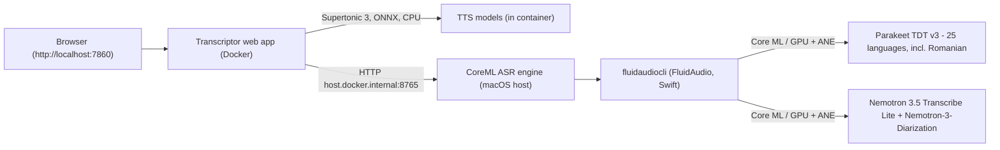

# Transcriptor

Local, private speech-to-text (including Romanian) and text-to-speech with a web
graphical interface, built around Apple Silicon Core ML models and deployed
with Docker on macOS.

- **Speech-to-text** runs on your Mac through
  [FluidAudio](https://github.com/FluidInference/FluidAudio) (Swift / Core ML /
  Apple Neural Engine):
  - [Nemotron 3.5 Transcribe Lite (Core ML)](https://huggingface.co/FluidInference/nemotron-3.5-transcribe-lite-coreml) -
    the ~600M-parameter ASR encoder + CTC timestamp head of NVIDIA Nemotron 3.5
    Transcribe, combined with
    [Nemotron-3-Diarization (Core ML)](https://huggingface.co/FluidInference/nemotron-3-diarization-coreml)
    for speaker-labelled English meeting transcripts at hundreds of times real
    time on Apple Silicon.
  - **Parakeet TDT v3 (0.6B)** - FluidAudio multilingual batch model covering
    25 European languages **including Romanian**. This is the default model for
    non-English audio.
- **Text-to-speech** runs inside the container with
  [Supertonic 3](https://github.com/supertone-oss-archive/supertonic) (ONNX
  Runtime, CPU): 31 languages **including Romanian**, 10 preset voices
  (M1-M5, F1-F5), speed and quality control.

Everything runs on your machine. No audio or text leaves the host.

## Architecture - please read first

Docker Desktop on macOS runs Linux ARM64 containers inside a virtual machine.
**Core ML and the Apple Neural Engine are macOS frameworks and cannot be used
from inside a Linux container.** This is a hard platform constraint, not a
packaging issue.

Transcriptor therefore uses a two-part design:

1. A small **ASR engine** runs natively on macOS and wraps the FluidAudio CLI
   (Core ML, GPU + Neural Engine). It exposes a local HTTP API on port 8765.
2. The **web application** (graphical interface + Supertonic TTS) runs in a
   Docker container on port 7860 and reaches the engine over
   `host.docker.internal`.



A fully native mode (no Docker) is also provided: `scripts/run_native.sh`.

## Models and language support

| Capability | Model | Languages | Speakers |
|---|---|---|---|
| Transcription (default) | Parakeet TDT v3 0.6B (Core ML) | 25 European languages, **incl. Romanian** | no |
| Transcription (English, higher accuracy) | Parakeet TDT v2 (Core ML) | English | no |
| Transcription (English, punctuation + casing) | Parakeet Unified (Core ML) | English | no |
| Meeting transcription | Nemotron 3.5 Transcribe Lite (Core ML) | English (validated) | **yes** (up to 8) |
| Text-to-speech | Supertonic 3 (ONNX) | 31 languages, **incl. Romanian** (`ro`) | 10 voices |

Note on Nemotron: the full NVIDIA Nemotron 3.5 Transcribe (30B) is multilingual,
but its Core ML "Lite" port keeps only the ASR encoder + CTC head without the
language model, and FluidAudio validates it on English (about 26% WER on AMI,
at roughly 500x real time). For Romanian and other non-English audio, use the
default Parakeet model, which officially covers Romanian.

## Requirements

- Apple Silicon Mac (M1/M2/M3/M4/M5), macOS 15 or newer (Core ML model requirement)
- Xcode Command Line Tools (Swift 6): `xcode-select --install`
- [Homebrew](https://brew.sh) and `ffmpeg` (`brew install ffmpeg`)
- Docker Desktop for Mac (Apple Silicon)
- Python 3.10-3.13 (engine service and native mode)
- About 6 GB of disk for models (Parakeet, Nemotron Lite encoder + CTC head
  about 1.6 GB, diarizer about 200 MB, Supertonic about 400 MB) and an internet
  connection for the first run

## Quick start (3 steps)

```bash
git clone https://github.com/CrisChir/Transcriptor.git
cd Transcriptor

# 1. Build the CoreML engine (FluidAudio CLI + Python service). One time only.
bash engine/setup.sh

# 2. Start the engine on the macOS host (downloads models on first use).
bash engine/run.sh

# 3. Start the web GUI in Docker (new terminal).
docker compose up -d --build
```

Open http://localhost:7860. The status bar must show "ASR engine: online".
The single-command alternative is `bash scripts/start.sh`.

## Step details

### 1. Engine setup (`engine/setup.sh`)

Verifies macOS/Apple Silicon, installs `ffmpeg` if missing, clones FluidAudio
(ref configurable via `FLUIDAUDIO_REF`, default `main`), builds
`fluidaudiocli` in release mode, creates a Python virtualenv for the engine
service and optionally warms up the models (pass `--skip-warmup` to skip).
The warm-up runs each model once on 2 seconds of silence, so the multi-GB model
download and the one-time Neural Engine compilation of the diarizer (about
80 s) happen before you need them.

### 2. Engine start (`engine/run.sh`)

Runs a FastAPI service on port 8765, binding to 0.0.0.0 so the Docker VM can
reach it via `host.docker.internal`. macOS may show a firewall prompt on the
first start - allow it. In native mode you can export
`ENGINE_HOST=127.0.0.1` to restrict the service to localhost.

### 3. Docker web app

`docker compose up -d --build` builds the container, downloads the Supertonic 3
ONNX assets (pinned HF revision) into the `supertonic-models` volume and serves
the GUI on port 7860.

## Using the interface

### Transcription

1. Open the **Transcribe** tab.
2. Drop or select an audio/video file (wav, mp3, m4a, mp4, mov...; the engine
   converts everything to 16 kHz mono with ffmpeg). Limit defaults to 500 MB
   (`MAX_UPLOAD_MB`).
3. Pick a model:
   - **Parakeet TDT v3 (multilingual, incl. Romanian)** - default, best for
     Romanian audio.
   - **Parakeet v2 / Unified (English)** - higher accuracy / punctuation.
   - **Nemotron 3.5 Transcribe Lite (English meetings)** - speaker-labelled
     turns, extremely fast.
4. Press Transcribe. The transcript appears with copy and download buttons;
   for Nemotron, speaker turns with timestamps are shown.

### Text-to-speech

1. Open the **Text-to-speech** tab.
2. Enter text (Romanian is the default language).
3. Choose a voice (M1-M5 male, F1-F5 female), speed (0.7-2.0) and quality steps
   (5-12, default 8).
4. Press Generate. An audio player appears with a download link (44.1 kHz WAV).

## API

```bash
# Health / status
curl http://localhost:7860/api/health

# Available ASR models, voices, languages
curl http://localhost:8765/models
curl http://localhost:7860/api/config

# Transcribe a file (model: parakeet-v3 | parakeet-v2-en | parakeet-unified-en | nemotron35-en)
curl -X POST http://localhost:7860/api/transcribe -F "file=@meeting.m4a" -F "model=parakeet-v3"

# Synthesize speech (Romanian)
curl -X POST http://localhost:7860/api/tts -H 'content-type: application/json' -d '{"text":"Buna ziua! Aceasta este o sinteza vocala locala.","lang":"ro","voice":"F1"}' -o speech.wav
```

Engine endpoints (direct, on the host): `GET /health`, `GET /models`,
`POST /asr` (multipart: file, model).

## Configuration

Environment variables (put them in `.env`, see `.env.example`):

| Variable | Default | Purpose |
|---|---|---|
| `ASR_ENGINE_URL` | `http://host.docker.internal:8765` | Where the container finds the CoreML engine |
| `MAX_UPLOAD_MB` | `500` | Upload size limit for transcription |
| `ENGINE_HOST` | `0.0.0.0` | Engine bind address (use `127.0.0.1` in native mode) |
| `ENGINE_PORT` | `8765` | Engine port |
| `FLUIDAUDIO_CLI` | `engine/vendor/FluidAudio/.build/release/fluidaudiocli` | Path to the CLI binary |
| `FLUIDAUDIO_REF` | `main` | FluidAudio git ref used by setup.sh |
| `SUPERTONIC_MODEL_DIR` | `/models/supertonic` (container) | Where Supertonic assets are stored |
| `ASR_TIMEOUT` | `3600` | Engine CLI timeout in seconds |

## Native mode (no Docker)

```bash
bash engine/setup.sh && bash engine/run.sh        # terminal 1 (engine)
bash scripts/run_native.sh                        # terminal 2 (web app, http://localhost:7860)
```

## Troubleshooting

- **"ASR engine: offline" in the GUI** - start it with `bash engine/run.sh`,
  then check `curl http://localhost:8765/health`. For Docker mode the engine
  must listen on 0.0.0.0 (the default).
- **First Nemotron run seems stuck** - the diarizer compiles once for the
  Neural Engine (about 80 s) and models download on first use (GBs). Run the
  setup warm-up to do this ahead of time.
- **`fluidaudiocli not found`** - run `bash engine/setup.sh`, or set
  `FLUIDAUDIO_CLI` to your binary.
- **macOS firewall prompt** - allow incoming connections for Python/uvicorn;
  the engine only serves your local Docker VM and LAN.
- **Transcript looks like progress logs (Parakeet)** - your FluidAudio build
  does not support `--output-json`; the raw CLI output is returned as a
  fallback. Update FluidAudio (`cd engine/vendor/FluidAudio && git pull`, then
  rebuild).
- **TTS first start is slow** - the container downloads about 400 MB of
  Supertonic assets on first boot; they persist in the `supertonic-models`
  volume.

## Repository layout

```
engine/     CoreML ASR engine (macOS host): setup.sh, run.sh, main.py
app/        Web application (Docker): FastAPI + GUI, Supertonic TTS
scripts/    start.sh (engine + Docker), run_native.sh (no Docker)
```

## Credits and licenses

- [FluidAudio](https://github.com/FluidInference/FluidAudio) and the Core ML
  ports [nemotron-3.5-transcribe-lite-coreml](https://huggingface.co/FluidInference/nemotron-3.5-transcribe-lite-coreml),
  [nemotron-3-diarization-coreml](https://huggingface.co/FluidInference/nemotron-3-diarization-coreml)
  (MIT/Apache-2.0 models; Nemotron weights under NVIDIA OpenMDW 1.1).
- [Supertonic 3](https://github.com/supertone-oss-archive/supertonic) and
  [supertonic-py](https://github.com/supertone-oss-archive/supertonic-py), MIT;
  weights from
  [supertone-oss-archive/supertonic-3](https://huggingface.co/supertone-oss-archive/supertonic-3).
- This project: MIT (see LICENSE).
